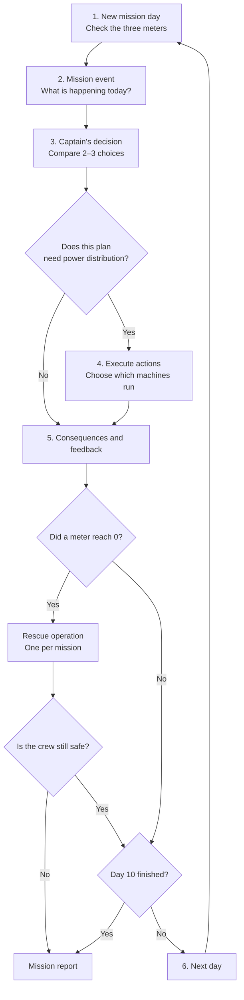

# SOLBOUND: Junior Astronaut Mission Trainer

SOLBOUND is a short mission game for young captains. You run a Moon or Mars outpost for **10 mission days**, keeping three meters alive:

- **Life Support** — air, water and food for the crew
- **Power** — electricity stored in the batteries
- **Protection** — walls and shields against space radiation

The game is built with Next.js 16, React 19, TypeScript, Tailwind CSS 4, Framer Motion and Zustand.

## Quick start (Windows)

Double-click **`START.bat`**.

It starts the game and opens [http://localhost:3010](http://localhost:3010) in your browser. Keep the black window open while you play; close it to stop the game.

- `START.bat` — runs the ready-built game (fast, use this one).
- `START-DEV.bat` — development mode with live reload, for editing code.

Requires Node.js 20 or newer. Everything else is already installed in `node_modules`.

## Run the game manually

```bash
npm install
npm run dev
```

Open [http://localhost:3000](http://localhost:3000). To make a production build, run `npm run build`, then `npm run start`.

## Before Day 1: base setup

The title screen and mission setup come first. After the captain confirms a destination and difficulty, a four-step onboarding flow introduces the base:

1. **Welcome** — NOVA greets the captain and previews the starting meters.
2. **Meet the Crew** — Amara (Leadership), Chen (Engineering), Ortiz (Plant Science) and Sami (Research).
3. **Build your base** — drag and drop, or tap, the Habitat, Solar Panels, Oxygen System and Greenhouse onto the green plots. The Habitat must be built first. Each building adds a small starting bonus.
4. **Colony ready** — review the colony, the mission goal and the boosted starting meters, then select **Begin Day**.

| Building | Starting bonus |
| --- | --- |
| Habitat | Life Support +4 |
| Solar Panels | Power +6 |
| Oxygen System | Life Support +3 |
| Greenhouse | Life Support +2, Protection +2 |

The bonuses keep the 10-day economy intact: they reward the setup step without removing the trade-offs in the daily loop.

## Comic book flipbooks

The **Comic Book** button appears on the title screen, the mission setup screen, the first base-setup page, and in the mission top bar. It opens an interactive Heyzine flipbook inside a popup:

- **Moon mission:** lunar edition
- **Mars mission:** Martian edition

The popup closes with the X button, the Escape key, or a click on the dark background. If the embedded viewer is blocked by the browser, use **Open in new tab** in the popup header.

## Nova, the AI mission assistant

From the mission setup screen onward, **Nova** is available as a real AI chat assistant. The title screen stays clean; every later screen shows a cyan sparkle button (**Ask Nova**) in the top bar.

Nova is not a generic chatbot. Every question is sent with the live state of the mission:

- the three meters and the weakest one,
- the running machines and their power cost,
- the event on screen and each choice's advantage and disadvantage,
- the last result and the last three decisions,
- the current NASA data source (live or archived).

And it answers as Nova, the same character the children already met: short, warm, jargon-free, 2–3 tips, always tied back to a trade-off. It replies in **English or Arabic**, whichever the child used.

### How the trade-off teaching stays safe

- **No invented numbers.** The route rejects empty or oversized questions and sends only the numbers the game owns.
- **No free win.** The persona must point out the cost of each option instead of promising a perfect choice.
- **No dead robot.** If the cloud call fails, the chat answers locally from the same game state and the NASA glossary, and labels the message as a local answer.
- **No exposed key.** The Groq key lives in `.env.local` and is used only by the server route `/api/nova`. It is never sent to the browser.
- **Child-safe limits.** Questions are capped at 600 characters, history at 8 turns, and each visitor at 24 questions per minute.

The chat footer names the datasets it is grounded in and links straight to the Science Library, so a player can check the science behind an answer.

### Configuration

`.env.local` already contains a working key:

```bash
GROQ_API_KEY=gsk_...
GROQ_MODEL=openai/gpt-oss-120b
```

Copy `.env.example` if you need to set up a new machine. Rotate the key before publishing the project publicly: a demo key that people can read in a shared folder should be treated as temporary.

If the key is missing or invalid, the game still works and Nova falls back to the local brain.

## Communication delay

Radio travels at the speed of light, but space is big, so distance becomes delay. SOLBOUND shows the real light-time on every mission screen (top bar: **Earth 1.3 s** on the Moon, **Earth 3–22 min** on Mars) and the day screen adds an **Earth mail** card that says what that delay does to a conversation:

- On the Moon the crew can still be talked through a repair almost live.
- On Mars the reply arrives after the problem has already moved on, so the crew must decide first and hear back later.

The delay is also played, not just displayed. Each mission reserves one **comms day**:

- **Mars, Sol 3 — "Earth's Reply Is Late":** trust local sensors, wait for Earth, or split the team.
- **Moon, Day 7 — "Drive the Rover from Earth":** let Earth drive with a 2.6 s round trip, drive locally, or park the rover.

All three options cost something: waiting burns life support, acting early risks a blind decision, and parking the rover loses a day of science. Nova also knows the delay, so a child can ask why Earth cannot answer in time.

## The gameplay loop

Every day follows the same six steps:



### 1. New mission day

The day screen shows all three meters, the crew's mood, a reminder of yesterday's decision, the Earth mail card with the real light-time delay, and any space-weather watch. Select **Start Today's Briefing** when you are ready.

### 2. Mission event

NOVA explains what is happening. Each event lists **What could happen?** before you decide. Real NASA DONKI space-weather events can replace the hand-written event when the live API is available.

### 3. Captain's decision

Every event offers two or three strategies. Every strategy shows:

- its **advantage** (green), and
- its **disadvantage** (amber).

There is no perfect choice. Compare the costs with your weakest meter, then confirm.

### 4. Execute actions (only when relevant)

Some choices ask for a **power plan**. You can switch the Greenhouse, Research Lab and Extra Lights on or off. The **Oxygen System is always on**, because the crew must breathe. The screen previews the next day's meters before you confirm.

Power plans last for one day. Each new morning starts from the safe default so an old plan cannot quietly weaken the base.

### 5. Consequences and feedback

After the day resolves you see:

- the before/after value of all three meters,
- a breakdown of every change (decision, machines, solar array, daily needs, planet conditions),
- **NOVA's lesson**, and
- **What did you learn?**, one idea to remember.

### 6. Next day and rescue

If a meter reaches **0**, the crew gets **one rescue operation per mission**. Each rescue option shows its cost, and an option is disabled if it would empty another meter. If the base cannot be kept alive after the rescue, the mission ends and the report explains why.

Choices leave memory tags, so later events can follow up on what you did (for example, rationing water can bring the recycler back).

## Daily economy

Each day starts with:

| Change | Amount |
| --- | --- |
| Crew needs | Life Support −10, Protection −5 |
| Solar array | Power +6 (Mars dust days and Moon nights reduce it) |
| Oxygen System (locked on) | Power −4, Life Support +6 |
| Greenhouse | Power −2, Life Support +2 |
| Research Lab | Power −3, Protection +4 |
| Extra Lights | Power −1, Life Support +1 |

- **Mars:** power is slightly lower each day; dust storms reduce solar output.
- **Moon:** the long lunar night starts on day 6 and cuts solar power while the base gets colder.

All meters are simplified game values, not real mission measurements.

## Winning and stars

Finish all **10 days** with every meter above zero to secure the outpost.

- **3 stars:** every meter ends at **55 or higher**, and you never needed a rescue.
- **2 stars:** every meter ends at **30 or higher**.
- **1 star:** you finish below those thresholds, or the mission ends early.

Replays keep your name, base name and accessibility settings.

## Real data

- **DONKI space weather** (`/api/space-weather`) is fetched live when possible. Real flares and coronal mass ejections can become that day's event and are labelled **Live** in the event card.
- **OSDR** (`/api/osdr`) searches real NASA space-biology studies by keyword, and the Science Library surfaces them beside the glossary.
- **RadLab** radiation dose readings are bundled as archived reference data for the protection lesson.
- If a live call fails, the game uses the saved dataset and hand-written stories. Those facts are labelled **Archived**, never as live.
- Nova, the AI assistant, receives the same source label (live or archived, plus the date) with every question, so it cannot describe static data as current.

Set `NASA_API_KEY` in `.env.local` to raise the DONKI request limit. Without it the app uses NASA's `DEMO_KEY`.

## Why this design answers the challenge

| Challenge ask | How SOLBOUND answers it |
| --- | --- |
| Real engineering trade-offs | Every decision shows one upside and one cost; several choices also open a power-plan step. |
| Two or three core resources | Exactly three meters: Life Support, Power, Protection. |
| Food production | The Greenhouse is a powered food system: it feeds Life Support every day, and the **"Greenhouse Needs Attention"** event trades grow-light power against the harvest. |
| Communication delay | The real light-time is on screen (1.3 s / 3–22 min), one mission day is a comms day, and waiting for Earth costs life support while acting early risks a blind call. |
| Kids 7–12 | Plain language, one screen per step, Nova reads the situation aloud on screen. |
| No free "safe" choice | The engine always applies a cost; the daily economy drains Life Support and Protection even on a calm day. |
| Real NASA data, clearly attributed | DONKI, OSDR and RadLab, each labelled **Live** or **Archived** with a date. |
| Consequences the player can see | Before/after meters, a full breakdown, the lesson, and a "What did you learn?" takeaway. |
| Replayability | Thirteen hand-written events, live space weather, decision memory tags, three difficulties, two worlds. |
| Learning without punishment | One rescue operation per mission, then a report that explains what failed. |
| An AI that helps rather than replaces thinking | Nova is grounded in the current game state and NASA data, points out costs, and never gives a free answer. |
| Low barrier to entry | Browser game, no account, no download; `START.bat` runs it locally. |

## Accessibility

The title screen and settings panel include **Large text** and **Reduced motion**. Sound effects and background music can be toggled separately, and the preference is remembered in the browser.

## Project layout

- `lib/game/constants.ts` — meter names, starting supplies, daily drain, systems
- `lib/game/types.ts` — all game types
- `lib/game/engine.ts` — daily resolution, rescue options, stars, event choice
- `lib/game/events.ts` — 13 hand-written events and their follow-ups, including the Moon and Mars comms days
- `lib/game/spaceWeather.ts` — DONKI normalization and live event override
- `lib/game/store.ts` — the Zustand state machine for the loop
- `components/game/EarthMail.tsx` — the light-time delay card on the day screen
- `lib/game/novaContext.ts` — the compact game/NASA context sent to Nova, plus the offline fallback answers
- `app/api/nova/route.ts` — the streaming server route that talks to Groq
- `components/game/NovaChat.tsx` — the chat panel, streaming reader, suggestions and history
- `components/game/NovaButton.tsx` — the "Ask Nova" trigger used in the top bars
- `components/game/*Screen.tsx` — one component per stage of the loop, plus the four-step `SetupScreen` onboarding flow

## Deployment

Push the project to GitHub and import it into Vercel. Add `GROQ_API_KEY` and `GROQ_MODEL` as environment variables in the Vercel project. No database is required.

Never commit `.env.local`. A public deployment should also add authentication or a stricter rate limit to `/api/nova`, because the route spends your Groq quota.
